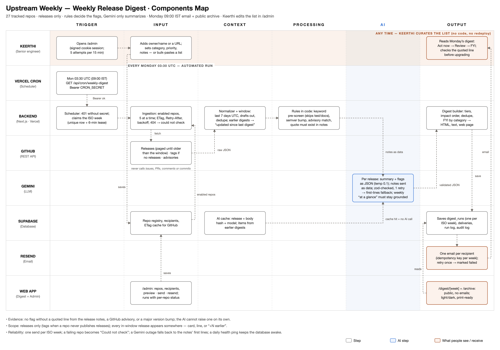
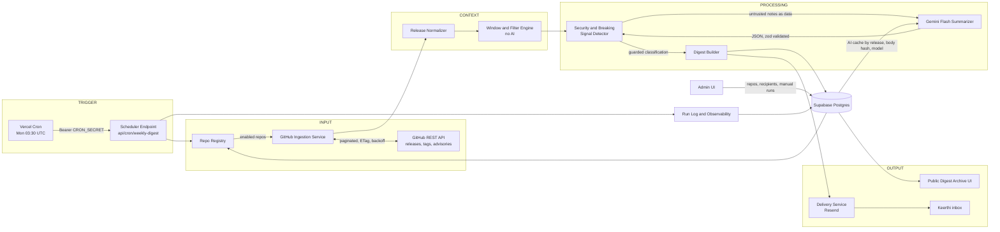
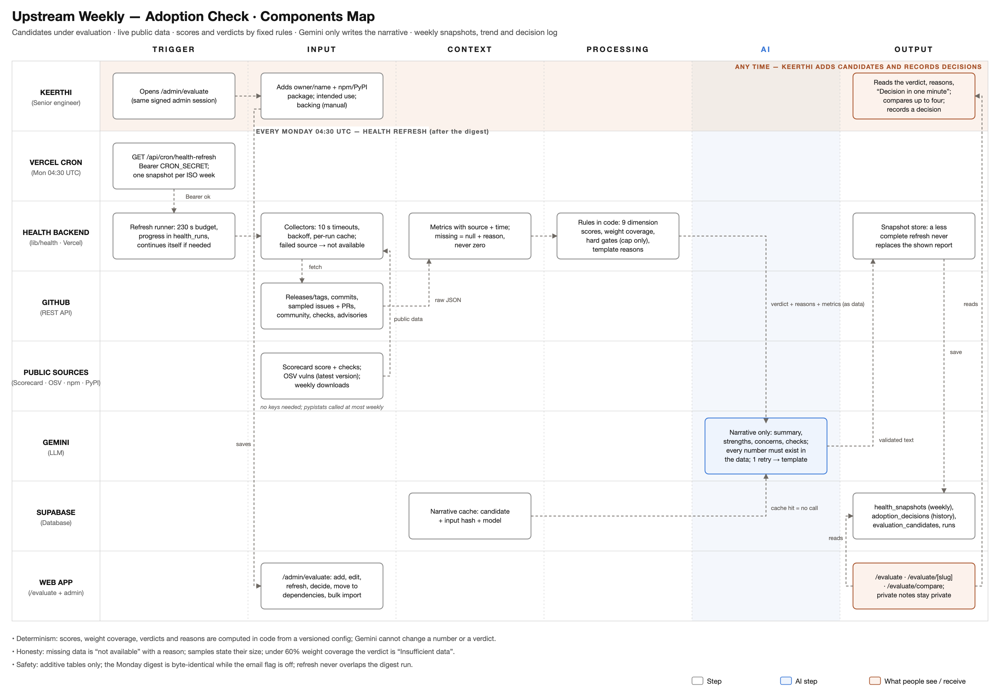
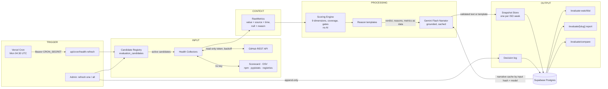

# Upstream Weekly — Weekly Release Digest · Components Map

27 tracked repos · releases only · rules decide the flags, Gemini only summarizes · Monday 09:00 IST email + public archive · Keerthi edits the list in /admin

*Source: [`components-map.svg`](components-map.svg). The layout follows the reference map in [`reference/sample-components-map.png`](reference/sample-components-map.png): the same lanes × Trigger/Input/Context/Processing/AI/Output grid, a tinted AI column, a phase band across the top lane ("Any time — Keerthi curates the list") with a labelled phase boundary below it ("Every Monday 03:30 UTC — automated run"), dashed elbow arrows, plain "• Label: detail" footer notes, and the same three-item legend.*

- **Evidence:** no flag without a quoted line from the release notes, a GitHub advisory, or a major version bump; the AI cannot raise one on its own.
- **Scope:** releases only (tags when a repo never publishes releases); every in-window release appears somewhere: as a card, a line, or "+N earlier".
- **Reliability:** one send per ISO week; a failing repo becomes "Could not check"; a Gemini outage falls back to the notes' first lines; a daily health ping keeps the database awake.

| Legend | Meaning |
| --- | --- |
| ⬜ **Step** | App, service or rules-in-code step (deterministic, no AI) |
| 🟦 **AI step** | Gemini Flash: summarize and classify only, validated and grounded |
| 🟧 **What people see / receive** | Keerthi's digest, the email, and the public pages |

---

## 1. Data flow (Mermaid)

## 2. Component table

| Component | Responsibility | Key files | Inputs | Outputs | External dependency | Failure behavior |
| --- | --- | --- | --- | --- | --- | --- |
| 1. Repo Registry | CRUD for tracked repos; validates and normalizes input and confirms the repo on GitHub before saving | `lib/repos/service.ts`, `lib/repos/normalize.ts`, `db/schema.ts` (`repos`) | Admin form, bulk paste, seed | Enabled `RepoRef[]`, per-repo `last_status` | GitHub (existence check) | Invalid input is rejected before any API call; a missing or private repo gets an inline error; soft delete keeps history |
| 2. GitHub Ingestion Service | Fetches releases (tags as a fallback) and repository advisories for each enabled repo | `lib/github/client.ts`, `lib/github/releases.ts`, `lib/github/ingest.ts` | Repos and window | Raw releases, advisories, per-repo status | GitHub REST API `2022-11-28` | 404 → `not_found`; 403/429 → waits for Retry-After, otherwise `rate_limited`; 5xx → exponential backoff; one repo failing never fails the run |
| 3. Release Normalizer | Turns raw payloads into the `NormalizedRelease` model and strips noise (contributor lines, compare links, HTML comments) | `lib/normalize/release.ts` | Raw JSON | `NormalizedRelease` with `body_hash` and `notes_available` | — | Anything that isn't a release payload (an issue, PR or commit) returns `null` and is dropped |
| 4. Window & Filter Engine | 7-day UTC window (inclusive), drops drafts, dedupes, caps FYI items per repo, change-aware history | `lib/filter/window.ts`, `lib/filter/filter.ts` | Normalized releases, run time | In-window releases, newest first | — | Pure functions; no I/O |
| 5. Security & Breaking Signal Detector | Keyword pre-screen (ignores test, docs and CI lines), semver major bump, advisory match, verbatim evidence check, prompt-injection stripping | `lib/signals/*`, `lib/ai/guardrails.ts` | Release title and body, advisories, AI output | Final flags with evidence | — | The AI cannot raise a flag alone; unverified quotes are downgraded to Review with low confidence |
| 6. AI Summarizer (Gemini Flash) | Per-release summary and classification as schema JSON; weekly at-a-glance synthesis | `lib/ai/gemini.ts`, `lib/ai/prompts.ts`, `lib/ai/schema.ts`, `lib/ai/classify.ts` | Notes (max 12,000 characters, delimited as data) | Validated `ReleaseAnalysis`, token usage | Gemini API (`gemini-3.8-flash`) | Retries once with the validation error; then a first-lines fallback (`ai_status = fallback`). A circuit breaker opens after 3 outages. Results are cached per release, body hash and model |
| 7. Digest Builder | Tiers, impact ordering, duplicate collapse, FYI grouped by category, explanations and next steps, subject line, HTML and text rendering | `lib/digest/*` | Classified releases, repo outcomes | `DigestModel`, email HTML, plain text | — | Always produces a digest, including a designed all-quiet week |
| 8. Delivery Service | One email per recipient, with a Resend idempotency key per week; records every attempt | `lib/delivery/email.ts`, `lib/delivery/recipients.ts` | Digest, recipients | `digest_deliveries` rows | Resend | Retries once; the run is then marked `failed` and shown in /admin/runs; a second cron call can retry |
| 9. Scheduler Endpoint | Cron entry point: Bearer auth, ISO-week lease, time-budgeted continuation | `app/api/cron/weekly-digest/route.ts`, `lib/pipeline/run.ts` | Vercel Cron request | Run result JSON | Vercel Cron | 401 without the secret; a duplicate call is `skipped: already_sent`; when out of time it re-invokes itself and resumes from cache |
| 10. Admin UI | Password login, repo table (search, filters, inline edit, toggle, remove), bulk import, recipients, preview, send and resend, run log | `app/admin/**`, `components/admin/*`, `lib/auth/*`, `proxy.ts` | Admin actions | DB writes and audit log | — | Optimistic updates roll back on error; destructive actions need confirmation; login is rate-limited |
| 11. Public Digest Archive UI | `/`, `/digest/[week]`, `/archive`; themed, printable and accessible | `app/page.tsx`, `app/digest/**`, `app/archive/**`, `components/digest/*` | `digest_runs.model_json` | HTML pages (ISR, 5 min) | — | Designed empty, loading and error states; never shows emails |
| 12. Run Log & Observability | Records each run's phase, counts, per-repo status, errors and Gemini tokens; structured JSON logs; health endpoint | `lib/pipeline/store.ts` (`pipeline_runs`), `lib/log.ts`, `app/api/health/route.ts` | Pipeline events | `/admin/runs`, logs, `/api/health` | — | Health returns 503 with the names of missing config (never values) |

## 3. Brief requirement → component(s)

| Requirement | Satisfied by |
| --- | --- |
| Monday digest of the **past 7 days** | 9 Scheduler (cron `30 3 * * 1`, run time pinned to the scheduled slot) and 4 Window & Filter (`[run − 7d, run]` UTC) |
| **Exclusions** (issues, PRs, comments, commits, stars, drafts) | 2 Ingestion only calls the releases, tags, commit-date-for-tag and advisories endpoints; 3 Normalizer rejects non-release payloads; 4 drops drafts |
| **Security and breaking flags at the top** with evidence | 5 Signal Detector and 6 AI, then 7 Builder tiers (Act now → Review → FYI) and impact ordering |
| **Scannable in five minutes** | 7 Builder (summary bar, one-line summaries, cap of 3 per repo, category grouping) and 11 UI (progressive disclosure) |
| **Editable list without code or redeploy** | 1 Registry in Postgres and 10 Admin UI |
| **Delivered every Monday automatically** | Vercel Cron, 9 Scheduler and 8 Delivery (idempotent per ISO week) |
| **Live data** | 2 Ingestion calls GitHub at run time; fixtures exist only under `tests/` |
| **Gemini-only AI** | 6 `lib/ai/gemini.ts` is the only module that calls a model, using `@google/genai` |
| **UI/UX standard** | 11 Public UI and 10 Admin UI ([`DESIGN.md`](DESIGN.md)): themes, print, axe-clean, Lighthouse ≥ 95 |

## 4. External services

| Service | Role | Auth / limits |
| --- | --- | --- |
| **GitHub REST API** | Releases, tags (fallback), commit dates for tags, repository security advisories, repo existence checks | Fine-grained read-only token; 5,000 requests per hour. Measured: a cold run makes 171 requests (3.4% of the hourly limit); a warm re-run gets 170 of them back as 304 Not Modified through ETags, which GitHub does not count |
| **Gemini API** | Per-release summary and classification, weekly synthesis | `GEMINI_API_KEY`, model `gemini-3.8-flash`, temperature 0.1, JSON schema output |
| **Resend** | Sends the weekly email (HTML and plain text) | `RESEND_API_KEY`; currently the `onboarding@resend.dev` test sender, which only delivers to the account owner |
| **Supabase Postgres** | All state: repos, releases, AI cache, digests, deliveries, recipients, run log, audit log | Transaction pooler (port 6543), free plan. Replaces Neon at the user's choice; the code runs on either |
| **Vercel Cron** | Monday trigger | Hobby: once a day at most, fires within the scheduled hour |
| **Vercel hosting** | Next.js app and functions (region `bom1`, next to the database) | Hobby: 300 s maximum function duration |

## 5. One weekly run, step by step

1. **03:30 UTC Monday** (09:00 IST): Vercel Cron calls `GET /api/cron/weekly-digest` with `Authorization: Bearer $CRON_SECRET`. Without the secret the route returns 401.
2. The **Scheduler** pins the run time to the scheduled slot, even if Hobby fires up to 59 minutes late. The window is `[Mon 03:30 − 7 days, Mon 03:30]` UTC and the ISO week is `2026-W42`.
3. It claims that week's `digest_runs` row. The unique ISO-week key and a 6-minute lease mean a duplicate invocation either waits or is skipped; an already-sent week is never re-sent unless an admin forces it.
4. The **Registry** loads enabled repos. **Ingestion** fetches them 5 at a time:
   - releases, paginated, stopping at the first release older than the window;
   - tags with commit dates, only for repos that never publish releases (or whose last release is over a year old);
   - published security advisories.
   ETags avoid re-downloading unchanged pages.
5. The **Normalizer** strips noise and hashes each body. The **Window & Filter** step keeps releases where `published_at` falls inside the window, drops drafts, and dedupes by release id and by repo and tag.
6. Releases are upserted. Earlier digests are consulted. Releases from the 4 weeks *before* the window are re-checked too: one already reported whose notes have changed since (by body hash) returns under "Updated since last digest", because weekly windows never overlap and an edit would otherwise go unseen.
7. **Classification:** cached results (by release, body hash and model) are reused. Otherwise Gemini Flash gets the notes inside explicit data delimiters, with 3 calls running at once. Every response is zod-validated, retried once, and falls back to the first lines of the notes if it still fails.
8. **Guardrails:** a flag survives only with pre-screen signals, a matched advisory or a major bump, *and* a quote that exists verbatim in the notes. Strong signals (CVE or GHSA IDs, "BREAKING CHANGE") can set a flag on their own. Lines from tests, docs and CI are ignored.
9. The **Digest Builder** assigns tiers, sorts by impact, collapses duplicates, groups FYI by category, writes one "why flagged" sentence and a next step per flagged item, and renders HTML and plain text. Gemini writes a 3-sentence summary, which is rejected if it mentions any version, ID or number not in its input.
10. The digest is saved, so `/digest/2026-W42` and `/archive` update. **Delivery** sends one email per recipient with a per-week idempotency key and records each attempt.
11. The **Run Log** stores phase, duration, per-repo status, errors and token usage, visible in `/admin/runs`. If classification ran out of time, the route re-invokes itself and resumes from the cache.

---

## 6. Adoption Check (added module)

Candidates under evaluation · live public data · scores and verdicts by fixed rules · Gemini only writes the narrative · weekly snapshots, trend and decision log. The module is additive: it adds six new tables and one cron, and no digest component changed behavior. The Monday email is byte-identical while the `email_watchlist_enabled` setting is off (pinned by `tests/unit/digest-golden.test.ts`).

*Source: [`components-map-adoption.svg`](components-map-adoption.svg), in the same style as the digest map above. The method behind every number is in [`HEALTH_METHOD.md`](HEALTH_METHOD.md).*

### 6.1 Data flow (Mermaid)

### 6.2 Component table

| Component | Responsibility | Key files | Inputs | Outputs | External dependency | Failure behavior |
| --- | --- | --- | --- | --- | --- | --- |
| 13. Candidate Registry | CRUD for candidates with audit, slugs, privacy (`notes_public`), archive, move to and from tracked dependencies, bulk import | `lib/health/store/index.ts`, `lib/health/bulk.ts`, `app/admin/evaluate-actions.ts` | Admin form, bulk paste, seed | Active candidates | GitHub (existence check) | Invalid lines are listed before import; nothing is written until confirmed |
| 14. Health Collectors | Fetch every metric live with 10 s timeouts, 2 retries, per-run cache and concurrency 4 | `lib/health/collect.ts`, `lib/health/sources/*` | Candidate | `RawMetrics` with source and time | GitHub, Scorecard, OSV, npm, pypistats, registries | A failed source becomes `null` with a reason, never zero; after a rate limit the GitHub run fails fast |
| 15. Scoring Engine | Nine dimension scores from versioned bands, weight coverage, verdict thresholds and cap-only gates | `lib/health/config.ts`, `lib/health/score.ts` | `RawMetrics` | `HealthReport` (scores, verdict, gates) | — | Pure functions; under 60% coverage the verdict is "Insufficient data" |
| 16. Reason Builder | Ordered, tagged template reasons (gates, concerns by weight, neutral, positives) | `lib/health/reasons.ts` | Report | `Reason[]` | — | Pure |
| 17. Narrative (Gemini Flash) | Summary, strengths, concerns, checks to make; grounding rejects any number not in the data or a verdict word that disagrees | `lib/health/ai/*` | Verdict, reasons, compact metrics (as delimited data) | Narrative JSON | Gemini API | One retry with the error, then a template narrative (`ai_status = fallback`); cached by candidate, input hash and model |
| 18. Snapshot Store & Refresh Runner | One snapshot per candidate per ISO week; completeness rule; resumable runs with a 230 s budget | `lib/health/refresh.ts`, `lib/health/store/*`, `app/api/cron/health-refresh/route.ts` | Reports | `health_snapshots`, `health_runs` | Vercel Cron | A less complete refresh keeps the shown report and records why; out of time → continues itself |
| 19. Adoption UI | Watchlist with filters, report with 7 sections and trend, compare up to 4 with Markdown copy, admin management | `app/evaluate/**`, `components/health/*`, `app/admin/(console)/evaluate/page.tsx`, `components/admin/candidate-manager.tsx` | Public-safe queries | HTML (ISR) | — | Private notes, backing and decision reasons never reach public pages unless marked public |
| 20. Decision Log | Append-only decisions (Evaluating, Adopted, Parked, Rejected) with reason, author and time | `adoption_decisions`, `recordDecision` | Admin | History on the report | — | Never edited or deleted in place |

### 6.3 Requirement → component(s)

| Requirement | Satisfied by |
| --- | --- |
| Health and risk from live data | 14 Collectors (no fixtures outside `tests/`) |
| Deterministic scoring; AI never scores | 15 Scoring and 16 Reasons; 17 only receives the verdict as data |
| Missing data is honest | `Metric<T>` with `null` + reason; coverage threshold; dashed "Insufficient data" chip |
| Weekly snapshots and trend | 18 (cron `30 4 * * 1`, after the digest at 03:30) |
| Compare up to four | 19 `/evaluate/compare` |
| Decision history | 20 Decision Log |
| Digest unchanged | Additive migration `0001`; golden tests; email section behind a flag, default off |

### 6.4 New external services (no keys)

| Service | Role | Limits |
| --- | --- | --- |
| [OpenSSF Scorecard API](https://api.securityscorecards.dev) | Security posture score and per-check results | Public; 404 means the repo is not scanned → "not available" |
| [OSV](https://osv.dev) | Known vulnerabilities for the package and whether they affect the latest version | Public; paginated via `next_page_token` |
| [npm downloads API](https://github.com/npm/registry/blob/main/docs/download-counts.md) and [registry](https://registry.npmjs.org) | Weekly downloads; latest version | Public |
| [pypistats](https://pypistats.org/api/) and [PyPI JSON API](https://pypi.org) | Weekly downloads; latest version | pypistats asks for light use: called at most once per candidate per week |
| GitHub REST API (existing token) | Releases and tags, commits, sampled issues and PRs, community files, check runs, advisories | Same read-only token; a 3-candidate refresh made about 31 requests per candidate |

